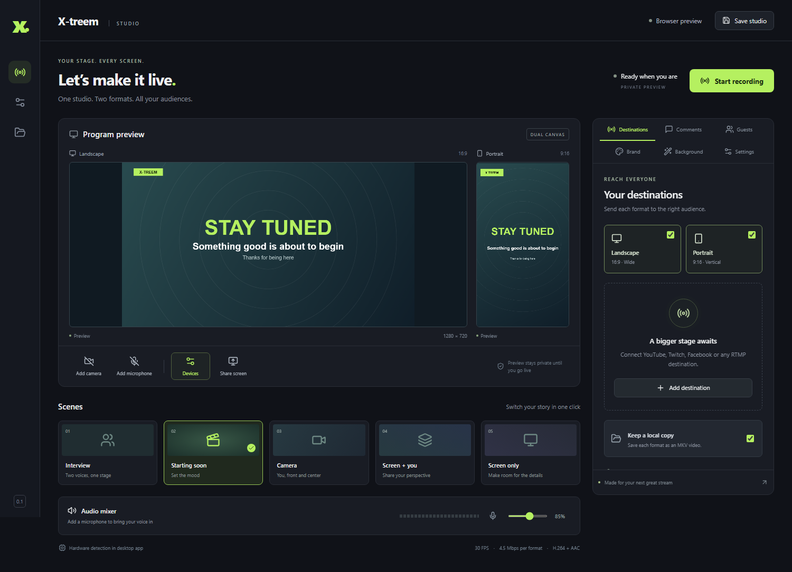

# X-treem Studio

A React desktop production studio for Windows. Compose a show once, preview it in landscape and portrait, and stream both formats at the same time.

**[Download the Windows installer](https://github.com/xunaidlnt-sudo/X-treem/releases)** · First release: **0.1.0 preview**



## In this release

- Independent 16:9 and 9:16 compositions, both active in one session.
- Up to eight RTMP/RTMPS destinations, each assigned an output format.
- NVIDIA NVENC, Intel Quick Sync and AMD AMF H.264 encoding when supported by the installed GPU and driver. Auto probes actual encoder startup; CPU encoding is the fallback.
- 720p / 1080p at 24, 30 or 60 fps, adjustable bitrate, AAC audio.
- Camera, screen/window capture, picture-in-picture, interview and starting-soon scenes.
- Browser guest mode: private invitation, recording-consent notice, host waiting-room approval and a two-person interview scene. Record the combined interview in both formats.
- Unified comments panel with private preview and explicit on-stream display. Native readers for YouTube live chat / Super Chat / Super Sticker descriptions and Twitch chat / Bits. Other platforms connect through a compatible relay.
- Host-triggered reaction animations and optional emoji reactions from connected chat. Paid-message cards preserve the source's displayed amount.
- Local person segmentation for background blur, color/image replacement and animated backgrounds. The model and runtime ship with the app; camera frames do not go to an AI service.
- Editable lower thirds, accent color, scrolling ticker and optional studio badge.
- Microphone selection, gain, mute, level meter and compression. Browser noise suppression, echo cancellation and automatic gain are requested; support depends on the device.
- Gentle color/contrast correction. This is not AI upscaling or restoration.
- A separate local MKV recording for every enabled format. MKV is resilient to interrupted recordings; common players including VLC can open it.
- Stream keys, chat credentials and studio preferences saved through Windows-backed Electron `safeStorage` encryption. Local production and direct RTMP streaming do not require an X-treem account.

## Quick start

1. Install `X-treem-Setup-0.1.0-x64.exe` from Releases on Windows 10/11 x64.
2. Open **Devices** beside the camera/microphone controls. Choose your camera, microphone and speakers/headphones; **Enable & detect devices** requests access and reveals device names. Refresh the list after connecting hardware. Add your camera and microphone, select a scene and adjust branding. **Save studio** remembers the selected devices.
3. Add a destination with its RTMP(S) server URL and stream key. Choose landscape or portrait for each destination. The service must provide RTMP ingest access; signing in to that service is done in its own dashboard.
4. Keep both output formats selected for simultaneous wide and vertical streaming. Each format needs a destination unless local recording is enabled.
5. Start a local recording to check framing, audio and performance. Then add your destinations and choose **Go live**.
6. Choose **End session** to finish the recordings, then open the recordings folder from the left rail. Files are saved in your Windows Videos folder under `X-treem`.

The preview is private until a session starts. Adding a destination does not transmit video. Camera and microphone access only begins when you enable their controls. Screen sharing has an explicit screen/window picker. System audio is not captured in this version.

## Guest interviews and recording

1. Add your camera and microphone, then open **Guests → Open interview room**.
2. Share the private invitation link with your guest. They can join in a supported desktop browser without installing X-treem.
3. The guest enters their name and acknowledges that the host may stream or record. The host must then press **Accept guest**.
4. The Interview scene frames both people side by side in landscape and stacked in portrait. Use headphones; guest audio is monitored locally and mixed into both outputs. Host-only audio is returned to the guest to avoid sending their voice back to them.
5. Keep **Local recording** enabled. Choose **Start recording** with no streaming destinations for a private recorded interview, or **Go live** to stream and record together.

An accepted guest receives your camera and microphone even before you go live. The initial release supports one host plus one guest. Guest mode uses PeerJS public signaling, Google STUN and PeerJS's configured public TURN servers when needed; encrypted WebRTC media can be relayed. Provider availability, firewalls and NAT conditions affect reliability. Guest links are valid while the host room stays open. The guest join page is hosted at [X-treem Guest Studio](https://xunaidlnt-sudo.github.io/X-treem/guest.html); guests need the full private invitation, including its fragment token.

## Comments, Super Chat and reactions

Open **Comments** to connect YouTube with a YouTube Data API v3 key and active video URL, or Twitch with a username, channel and authorized `chat:read` OAuth token. You can connect both at once. API credentials are supplied by the user; the app does not bypass account access or quotas.

Select a message to preview it privately, then press **Show on stream** to place it on both canvases. Paid messages use a distinct card. **Hide on-screen comment** removes the overlay. The built-in sample is clearly labeled and never represents a real payment. Reaction buttons animate emojis; optional incoming reactions come from chat text or relay events, not platform-wide reaction counts.

Facebook, Instagram, TikTok, Kick, LinkedIn and other services can receive RTMP streams when the account has ingest access. Their comments require a compatible authorized relay; native chat access to every platform is not claimed. See the [chat relay protocol and support details](docs/CHAT-RELAY.md).

## Background effects

Under **Background**, choose blur, removal with a solid color, an uploaded image, or the animated studio background. Enable the camera to start person detection. JPG, PNG and WebP images up to 2 MB are accepted. Detection runs in a worker at a reduced resolution/rate, with GPU inference where available and a CPU fallback. Edges depend on lighting, movement and the segmentation model. The original camera is shown while the model starts or if processing fails.

## Hardware and upload capacity

The interface and canvas compositor use Chromium graphics acceleration where available. Capture, composition and WebM transfer still use CPU; the selected GPU accelerates the final H.264 encode. There is one FFmpeg process/encode for each active format, shared across that format's destinations.

Two formats require two simultaneous encoder sessions. A successful small encoder probe does not guarantee the selected resolution/frame rate or two concurrent sessions will fit your device. If startup fails, select Software or lower resolution/frame rate and retry. A stable wired connection and 720p30 are sensible starting settings. Upload bandwidth grows with the number of destinations, including destinations sharing a format. The app estimates upload capacity with 30% headroom.

`Encoding` means frames are being encoded and sent to the output pipeline. It is not confirmation that a platform has publicly started the broadcast; check your platform dashboard. A destination failure aborts the corresponding FFmpeg output; the app reports the error. Automatic network reconnection is not included.

## Scope and known limitations

This is an initial local production release inspired by OBS/Streamlabs scene and audio controls and StreamYard's simple production workflow, with original UI and code. It is not affiliated with those products and does not claim full feature parity.

Guest ISO tracks, more than one remote guest, built-in platform OAuth, cloud recording/scheduling, AI upscaling, automatic stream reconnect, arbitrary image/video source overlays and system-audio capture are not included in 0.1.0. Portrait screen sharing fits the entire shared screen; camera scenes use a center crop. Stream keys containing muxer control characters are rejected rather than interpreted. Both output formats share the selected scene and text overlays; layout geometry differs by format.

The installer is unsigned because no code-signing certificate is configured. Windows may display an unknown-publisher prompt. Compare the release SHA-256 checksum before installation. GPU combinations and third-party streaming services require testing on your own hardware/accounts; local tests do not certify every service.

## Development

Use Node.js 24 and Windows x64 to build the installer:

```sh
npm ci
npm test
npm run start
npm run dist
```

`npm run dev` opens a browser preview server; native streaming and encrypted storage require the Electron app. `npm run dist` creates the NSIS executable under `release/`. The bundled FFmpeg binary is installed by `ffmpeg-static`, so a separate FFmpeg installation is not needed.

Run the native end-to-end test after `npm run build`:

```sh
npm run test:desktop
```

It creates isolated test settings and synthetic media in a temporary folder, exercises the actual Electron capture and IPC path, then decodes both output recordings and verifies dimensions, H.264 video and AAC audio. It never contacts a streaming platform or opens real camera/microphone devices.

The test also exercises local background inference and a synthetic chat relay. Set `XTREEM_TEST_INTERVIEW=1` for the optional PeerJS/WebRTC guest test. See [test evidence and limits](docs/TESTING.md).

## Architecture

`src/media.js` composes two canvases, mixes microphone audio and captures each enabled canvas with MediaRecorder. A narrow preload bridge sends bounded WebM chunks with backpressure to `electron/engine.cjs`. FFmpeg converts each input to H.264/AAC and fans out its encoded output using the tee muxer. The main process validates settings and owns process lifecycle, capture source selection, filesystem access and encrypted settings. Renderer Node integration is disabled, context isolation and sandboxing are enabled, and navigation/popups are blocked.

## License and dependencies

GPL-3.0-only. See [LICENSE](LICENSE) and [THIRD_PARTY_NOTICES.md](THIRD_PARTY_NOTICES.md). The source is available in this repository. FFmpeg is distributed unmodified with its license and build information. Electron's own licenses and Chromium notices are included in the installed app.

Reference: [StreamYard](https://streamyard.com/), [OBS](https://obsproject.com/), [Streamlabs Desktop](https://streamlabs.com/streamlabs-desktop), [MediaPipe segmentation](https://ai.google.dev/edge/mediapipe/solutions/vision/image_segmenter), [PeerJS](https://peerjs.com/docs/) and [Electron security guidance](https://www.electronjs.org/docs/latest/tutorial/security).
